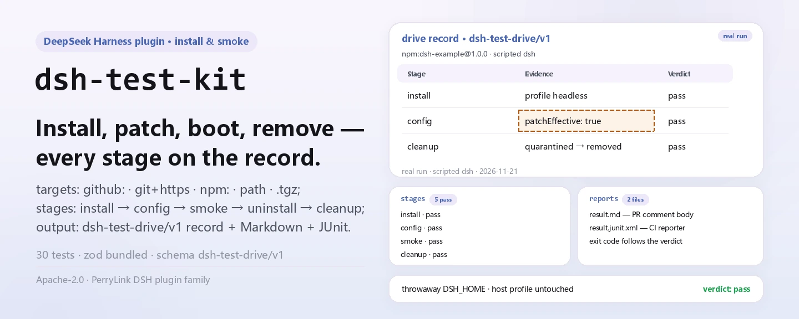
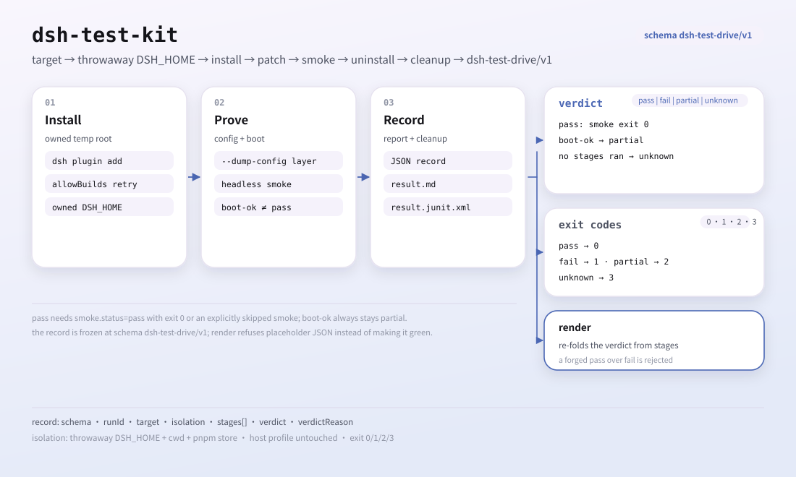
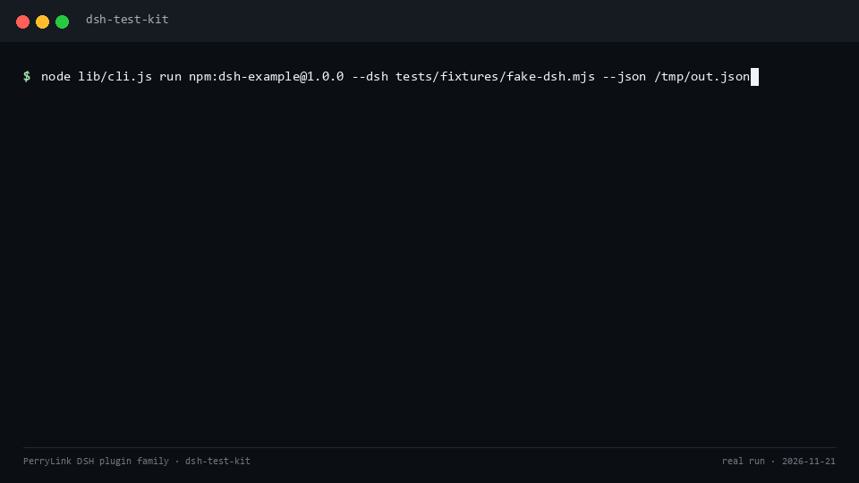

<div align="center">

<picture>
  <source media="(prefers-color-scheme: dark)" srcset="docs/assets/dsh-test-kit-hero-en-dark.webp">
  
</picture>

# dsh-test-kit

**Ejecuta la comprobación de instalación y arranque de un plugin de DeepSeek Harness fuera de DeepSeek Harness.**

*Instalar → probar el parche → arrancar sin credenciales → desinstalar → limpiar en un `DSH_HOME` desechable, con el registro congelado `dsh-test-drive/v1` y los informes Markdown/JUnit como única salida que cuenta.*

[English](README.md) · [简体中文](README-zh.md) · [Español](README-es.md) · [Português](README-pt.md) · [हिन्दी](README-hi.md)

[](https://github.com/PerryLink/dsh-test-kit/actions/workflows/ci.yml)
[](LICENSE)
[]()

</div>

`dsh-test-kit` es el hogar independiente del motor `dsh-test-drive` extraído.
Instala un objetivo en un perfil `DSH_HOME` desechable, verifica que la capa de
parche del bundle se haya montado de verdad, ejecuta un arranque en frío sin
credenciales, desinstala el paquete, limpia cada directorio que posee y escribe
el registro JSON congelado `dsh-test-drive/v1` más informes Markdown y JUnit.

Este repositorio es autocontenido: `src/core/` vive aquí, no hace falta ningún
checkout del monorepo, ninguna importación de runtime `@deepseek-ai/*` ni ningún
proceso anfitrión de DSH. Lo único que necesita un drive es el CLI `dsh`, pnpm y
acceso de red para la instalación del perfil desechable.

- **Arranca con Node a secas.** El CLI lleva `zod` empaquetado; un checkout limpio
  arranca con `node lib/cli.js --version`.
- **Nunca informa éxito ante salida desconocida.** El JSON ausente o inválido se
  rechaza; `fail`, `partial` y `unknown` tienen todos códigos de salida distintos de cero.
- **`boot-ok` no es `pass`.** Un arranque con salida distinta de cero y sin marcadores
  de fallo de carga es `partial`; `pass` exige un arranque real (`smoke.status=pass`,
  salida 0) o un smoke omitido explícitamente.
- **Aislamiento por construcción.** `DSH_HOME` desechable, cwd desechable y store de
  pnpm redirigido; el perfil anfitrión nunca se lee ni se escribe.
- **Informes saneados.** Los literales de token, las credenciales de URL, las
  cabeceras bearer y las rutas temporales se redactan antes de llegar a cualquier informe.

---

<picture>
  <source media="(prefers-color-scheme: dark)" srcset="docs/assets/dsh-test-kit-flow-v5-dark.svg">
  
</picture>

*Estructura: instalar → probar → registrar; `verdict` y el código de salida se derivan de `stages[]`, `render` vuelve a plegar el veredicto en vez de fiarse de la afirmación del propio registro, y las etiquetas dentro del diagrama son los nombres reales de fases, flags y ficheros, así que la misma imagen sirve para los cinco idiomas.*

## Estado

- **Fuente de verdad:** este repositorio. El paquete se extrajo del monorepo
  `dsh-test-drive` a un árbol autocontenido `src/` + `src/core/`.
- **npm:** todavía no lo publica este repositorio. La publicación la gestiona el
  propietario; hasta entonces, compila desde el código o usa la GitHub Action.
- **Schema:** congelado en `schema: "dsh-test-drive/v1"`. El kit no añade campos,
  así que los scorers y dashboards existentes siguen funcionando.
- **macOS:** verificado en CI alojado en GitHub (`macos-latest`, Node 24). La
  máquina de extracción no tiene hardware macOS, así que la ejecución local en
  macOS está **BLOQUEADA**; el job `macos-latest` de Actions es el resultado
  autoritativo para macOS.

## Requisitos

| Requisito | Notas |
|---|---|
| Node.js | `^22.19.0` o `>=24.9.0` |
| CLI `dsh` | cualquier build 0.2.x que ofrezca `plugin add` y `--dump-config`; pasa `--dsh <ruta>` o pon `dsh` en `PATH` |
| Red | solo para la instalación pnpm del perfil desechable |
| pnpm | el gestor `dsh plugin` usa su propio pnpm; hace falta un registry operativo |

## Instalación

Cuando el propietario publique el paquete:

```sh
npm install -g @perrylink/dsh-test-kit
dsh-test-kit --version
```

Mientras tanto, compila el checkout independiente:

```sh
git clone https://github.com/PerryLink/dsh-test-kit.git
cd dsh-test-kit
npm ci
npm run build
node lib/cli.js --version
```

`lib/cli.js` es una única entrada ESM autocontenida (zod empaquetado); la
compilación falla si zod se externaliza o si falta la cadena de schema congelada.

## Inicio rápido

```sh
# Un ref de GitHub (la ruta checkout/pack que los autores de plugins publican de verdad)
dsh-test-kit run github:owner/repo#<sha> --dsh /ruta/a/dsh --json out.json

# Un plugin publicado
dsh-test-kit run npm:dsh-score@0.2.28 --dsh /ruta/a/dsh --json out.json

# Un checkout local o un tarball
dsh-test-kit run ./my-plugin --json out.json
dsh-test-kit run ./my-plugin.tgz --json out.json

# Renderiza el par de informes de CI desde el registro asentado
dsh-test-kit render --input out.json --out-dir reports
```

`render` escribe `reports/out.md` (cuerpo del comentario de PR) y
`reports/out.junit.xml` (entrada del reporter de tests), y luego imprime una
línea JSON con las rutas absolutas y el veredicto.

## Objetivos

| Forma | Ejemplo | Notas |
|---|---|---|
| Ref de GitHub | `github:owner/repo#<sha>` | se pasa a `dsh plugin add` |
| URL git | `git+https://host/repo.git#ref` | cualquier spec git soportado por pnpm |
| Registry npm | `npm:name`, `npm:@scope/name@1.2.3` | el marcador `npm:` se elimina antes de instalar |
| Ruta local | `./plugin`, `/abs/plugin` | anclada al directorio de invocación |
| Tarball | `./plugin.tgz` | plugin empaquetado |

## El registro de resultados

```json
{
  "schema": "dsh-test-drive/v1",
  "run": { "runId": "tdr_…", "harnessVersion": "0.2.2-rc.3", "pluginVersion": "0.1.0", "…": "…" },
  "target": { "kind": "npm", "spec": "dsh-score@0.2.28", "resolved": { "packageName": "dsh-score", "packageVersion": "0.2.28", "hasBundleManifest": true } },
  "stages": {
    "install":   { "status": "pass", "…": "…" },
    "config":    { "status": "pass", "patchEffective": true, "layers": ["dsh-score"], "…": "…" },
    "smoke":     { "status": "boot-ok", "bootFailed": false, "taskCompleted": false, "…": "…" },
    "uninstall": { "status": "pass", "…": "…" },
    "cleanup":   { "status": "pass", "quarantined": true, "removed": true, "…": "…" }
  },
  "verdict": "partial",
  "verdictReason": "install, patch, and uninstall verified; boot smoke exited 1 without loader-failure markers, so a successful boot is not proven"
}
```

`verdict=pass` exige `smoke.status=pass` con salida 0, o un smoke omitido
explícitamente. Un arranque distinto de cero (`boot-ok`) es **siempre** `partial`.
Una matriz vacía es `unknown`, nunca `pass`.

### Veredictos

| Veredicto | Significado | Código de salida de `run` |
|---|---|---|
| `pass` | install, capa de parche y uninstall verificados, más un arranque real (`smoke.pass` con salida 0) o un smoke omitido explícitamente (task vacía / `--no-smoke`) | 0 |
| `fail` | falló install, el arranque encontró fallos de carga (incluido `Cannot find module`), o falló una aserción de capacidad | 1 |
| `partial` | install pasó pero el parche/arranque/desinstalación no pudieron verificarse del todo; `boot-ok` (salida distinta de cero) siempre está aquí | 2 |
| `unknown` | la combinación de fases no tiene regla concluyente (normalmente install nunca se ejecutó) | 3 |

## Reglas de integridad de `render` (arreglo P2)

`render` vuelve a plegar el veredicto a partir de las fases del propio registro
antes de escribir un informe. Un registro que **afirma `pass` mientras sus fases
dicen otra cosa** nunca se renderiza en verde:

- cualquier fase fallida (`install`, `config`, `smoke`, `capability`, `uninstall` o
  `cleanup`) → el informe muestra el `fail` derivado de las fases, salida **1**;
- evidencia parcial como `patchEffective: false` → el informe muestra `partial`,
  salida **2**;
- evidencia no concluyente → `unknown`, salida **3**.

Por tanto los códigos de salida de `render` son:

| Código | Significado |
|---|---|
| `0` | informes escritos desde un registro consistente |
| `1` | el registro afirmaba `pass` pero una fase es `fail` |
| `2` | el registro afirmaba `pass` pero la evidencia de fases es `partial` |
| `3` | el registro afirmaba `pass` pero la evidencia de fases no es concluyente |
| `64` | error de uso |
| `65` | la entrada no es un registro `dsh-test-drive/v1` (incluido JSON de relleno) |

Un JSON de relleno como `{"note":"replace this step"}` se **rechaza**, nunca se
renderiza como éxito.

### Qué comprueba cada fase en realidad

1. **install** — `dsh plugin --profile <name> add <target>` en el home desechable.
   Si una fuente git activa la puerta `allowBuilds` de pnpm, se permite y se
   reintenta una vez.
2. **config** — `dsh --profile <name> --dump-config`; el paquete instalado debe
   aparecer como layer o como row. El éxito de install por sí solo no basta.
3. **smoke** — una invocación headless. Salida 0 sin marcadores de fallo de carga
   es `pass`; una salida distinta de cero **no es un arranque verificado** y da
   `boot-ok` → veredicto `partial`; los fallos de carga/módulo (`Cannot find module`
   etc.) lo convierten en `fail`. Una task vacía omite la fase entera
   (install/parche/uninstall siguen dando `pass`).
4. **capability** (opcional) — demuestra que una tool/command concreta está
   registrada, se invoca y se observa en el log de sesión duradero. Necesita una
   credencial de modelo reenviada explícitamente; si no, la fase es `skipped`, no fallida.
5. **uninstall / cleanup** — elimina el paquete y ejecuta siempre la escalera de
   cuarentena → borrado de los directorios propios, incluso en abortos y errores
   de pipeline.

## GitHub Action

La action vive en la raíz del repositorio; referencia `@main` hasta que exista un
tag de release:

```yaml
name: test-drive
on: [pull_request, workflow_dispatch]
jobs:
  smoke:
    runs-on: ubuntu-latest
    steps:
      - uses: actions/checkout@v4
      - name: Install the dsh CLI (or use your own cache)
        run: npm install -g @deepseek-ai/dsh@0.2.2-rc.3
      - name: Drive this plugin
        id: drive
        uses: PerryLink/dsh-test-kit@main
        with:
          target: github:${{ github.repository }}#${{ github.sha }}
          # Optional: headless-task: 'Reply with exactly: ok'
          # Optional: dsh: /usr/local/bin/dsh
      - name: Publish JUnit
        uses: EnricoMi/publish-unit-test-result-action@v2
        with:
          files: ${{ steps.drive.outputs.junit }}
      - name: Comment the report
        run: cat "${{ steps.drive.outputs.markdown }}"
```

| Entrada | Por defecto | Propósito |
|---|---|---|
| `target` | — (obligatorio) | mismas formas de objetivo que el CLI |
| `headless-task` | `''` | vacío omite la fase de smoke |
| `dsh` | `dsh` | ruta absoluta, comando simple o `npm:<pkg>@<version>` |
| `node-version` | `24` | Node que usa el kit |
| `kit-version` | `latest` | solo se usa cuando el checkout no tiene kit local |
| `allow-partial` | `false` | `partial` pasa solo si se permite explícitamente |

Salidas: `markdown`, `junit`, `verdict`, `result`.

La action instala/compila el kit, ejecuta el drive con `--no-fail`, valida y
renderiza el registro, y luego **hace fallar el job ante `fail` o `unknown`** (y
ante `partial` salvo `allow-partial: true`). Nunca sustituye un resultado por relleno.

## Modelo de seguridad

- **Solo raíces temporales propias.** Cada directorio se crea con `mkdtemp` bajo el
  directorio temporal del SO con el prefijo `dsh-test-drive-`, se registra y se
  elimina mediante la escalera dry-run → rename a cuarentena → borrado.
  `assertOwned` rechaza cualquier otra cosa.
- **Perfil desechable.** El hijo recibe `DSH_HOME=<owned root>/home`, un cwd
  desechable y `npm_config_store_dir=<owned root>/store`. El `~/.dsh` real nunca se
  lee ni se escribe; el registro afirma `isolation.hostHomeTouched: false`.
- **Sin secretos implícitos.** El adaptador parte del entorno padre menos los
  nombres con forma de credencial (`/KEY|PASSWORD|SECRET|TOKEN/i`) y todos los
  nombres `DSH_*`; solo sobreviven los valores nombrados con `--forward-env`.
- **Salida saneada.** Cada cadena de informe pasa por los sanitizadores del motor;
  la salida de fase se recorta por bytes y las rutas temporales se redactan.

## Estructura del código

```
src/core/                  self-contained engine (10 modules)
  config.ts                defaults + fail-loud resolveConfig (no Schemastery)
  driver.ts                dsh location, argv-only spawning, allowBuilds, dump parsing
  drive.ts                 install → config → smoke → capability → uninstall → cleanup
  result.ts                frozen zod schema + verdictOf
  report.ts                Markdown + JUnit renderers
  workspace.ts             owned temp roots, quarantine ladder
  capability.ts            session-log capability analyzer
  session-log.ts           multi-frame zstd session reader
  sanitize.ts              secret/temp-path redaction
  version.ts               engine version

src/cli.ts                 run / render, argument parsing, exit codes
src/subprocess.ts          node:child_process adapter for the engine seam
action.yml                 composite GitHub Action
lib/cli.js                 built single-file bundle (committed so the Action needs no build)
tests/                     CLI + subprocess specs and the scripted fake dsh
```

La dirección de dependencias es única: el CLI importa el motor, el motor no
importa nada de DSH (las costuras de tipo viven en `driver.ts`) y solo
`subprocess.ts` inicia procesos. Eso es lo que hace que `dsh-test-kit run` pueda
arrancar con Node a secas.

## Desarrollo



*Animado: la salida real del CLI para `node lib/cli.js run npm:dsh-example@1.0.0 --dsh tests/fixtures/fake-dsh.mjs` seguida de `render` (re-ejecutado el 2026-11-21). El `dsh` aquí es el fixture con guion incluido en el repo, así que el ciclo completo run → registro → informes es real sin instalación de red ni host de DSH; un objetivo real usa el mismo comando con `--dsh /ruta/a/dsh`.*

```sh
npm ci
npm run typecheck      # tsc --noEmit over src/ and tests/
npm test               # vitest: CLI + subprocess specs
npm run build          # tsdown bundle + self-contained bundle guard
npm run verify         # verify lib/cli.js bundles zod and the frozen schema
node lib/cli.js run npm:dsh-score@0.2.28 --json /tmp/out.json
node lib/cli.js render --input /tmp/out.json --out-dir /tmp/reports
```

Los tests usan un `dsh` con guion (`tests/fixtures/fake-dsh.mjs`), así que el ciclo
completo run → JSON → render se ejercita sin instalación de red. El test de
regresión P2 falsifica `verdict: pass` sobre un install fallido y comprueba que
`render` sale con `1` y escribe un informe `fail`.

## CI

`.github/workflows/ci.yml` ejecuta `npm ci`, typecheck, tests, build y
`node lib/cli.js --version` en:

| Job | Runner | Node |
|---|---|---|
| `test` | `ubuntu-latest`, `windows-latest` | 22, 24 |
| `macos` | `macos-latest` | 24 |
| `action` | `ubuntu-latest` | 24 |

El job `action` ejecuta de extremo a extremo la composite action de este
repositorio contra el `dsh` con guion y afirma un veredicto `pass`. El job
`macos` existe porque la máquina de extracción no tiene hardware macOS
(ejecución local en macOS: BLOCKED); CI es la comprobación autoritativa en macOS.

## Límites de v0.1

- Un objetivo por `run`; las matrices por lotes siguen siendo una función solo del
  plugin (`/testdrive` + `drive-batch`).
- La fase de smoke no usa credenciales por defecto; reenviar una credencial de
  modelo es siempre una decisión explícita de `--forward-env`.
- Windows: el adaptador se niega a lanzar shims `.cmd`/`.bat`/`.ps1` directamente
  (sin shell). Pasa un `.exe` o una entrada JS/ESM (`.js`/`.mjs`/`.cjs`) — las
  entradas JS se lanzan a través de `node`.
- `--dsh npm:<pkg>@<version>` usa `npm exec --package=… -- dsh`; npm debe poder
  resolverse como entrada JS (el adaptador localiza `npm-cli.js`).
- Este repositorio todavía no crea ni un git tag ni un release de npm.

## Licencia

Apache-2.0. El `zod` empaquetado es MIT; ver [THIRD_PARTY_NOTICES.md](THIRD_PARTY_NOTICES.md).
