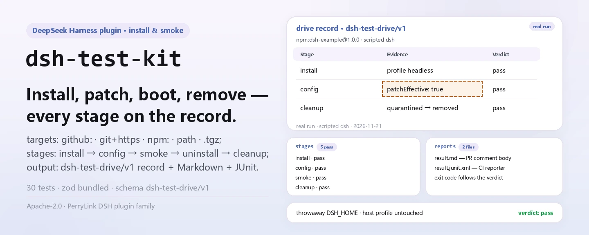
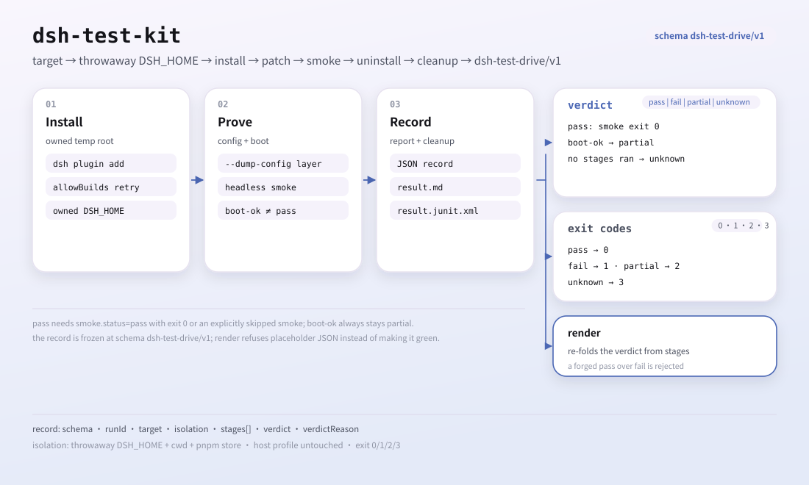
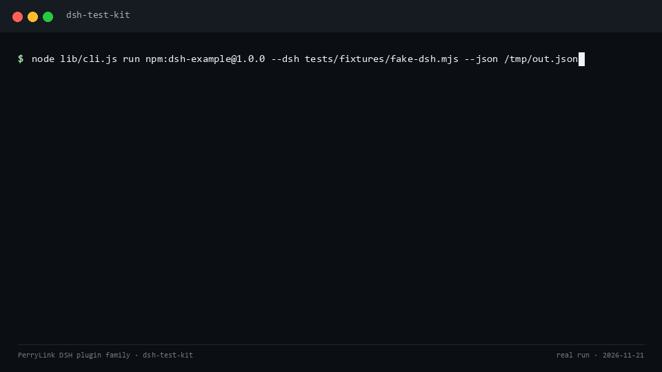

<div align="center">

<picture>
  <source media="(prefers-color-scheme: dark)" srcset="docs/assets/dsh-test-kit-hero-en-dark.webp">
  
</picture>

# dsh-test-kit

**DeepSeek Harness के बाहर किसी प्लगइन की इंस्टॉल-और-स्मोक जाँच चलाएँ।**

*एक थ्रोअवे `DSH_HOME` में इंस्टॉल → पैच का प्रमाण → बिना क्रेडेंशियल बूट → अनइंस्टॉल → क्लीनअप, और अंत में केवल फ़्रोज़न `dsh-test-drive/v1` रिकॉर्ड तथा Markdown/JUnit रिपोर्ट ही मायने रखती हैं।*

[English](README.md) · [简体中文](README-zh.md) · [Español](README-es.md) · [Português](README-pt.md) · [हिन्दी](README-hi.md)

[](https://github.com/PerryLink/dsh-test-kit/actions/workflows/ci.yml)
[](LICENSE)
[]()

</div>

`dsh-test-kit`, निकाले गए `dsh-test-drive` इंजन का स्वतंत्र घर है।
यह किसी लक्ष्य को थ्रोअवे `DSH_HOME` प्रोफ़ाइल में इंस्टॉल करता है, जाँचता है कि
बंडल पैच लेयर वास्तव में माउंट हुई या नहीं, बिना क्रेडेंशियल के एक बूट स्मोक
चलाता है, पैकेज अनइंस्टॉल करता है, अपने बनाए हर डायरेक्टरी को साफ़ करता है, और
फ़्रोज़न `dsh-test-drive/v1` JSON रिकॉर्ड तथा Markdown व JUnit रिपोर्ट लिखता है।

यह रिपॉज़िटरी स्वयं-निहित है: `src/core/` यहीं है, न monorepo checkout चाहिए,
न `@deepseek-ai/*` रनटाइम इम्पोर्ट, और न किसी DSH होस्ट प्रोसेस की ज़रूरत है।
एक ड्राइव को केवल `dsh` CLI, pnpm और थ्रोअवे प्रोफ़ाइल की इंस्टॉल के लिए नेटवर्क
एक्सेस चाहिए।

- **सादे Node से शुरू होता है।** CLI में `zod` बंडल है; साफ़ checkout सीधे
  `node lib/cli.js --version` से चल पड़ता है।
- **अज्ञात आउटपुट पर कभी सफलता नहीं।** गायब या अमान्य JSON अस्वीकार होता है;
  `fail`, `partial` और `unknown` सभी के एग्ज़िट कोड नॉन-ज़ीरो हैं।
- **`boot-ok` का मतलब `pass` नहीं।** लोडर-फ़ेलियर मार्कर के बिना नॉन-ज़ीरो बूट
  `partial` है; `pass` के लिए असली बूट (`smoke.status=pass`, एग्ज़िट 0) या स्पष्ट
  रूप से छोड़ा गया स्मोक ज़रूरी है।
- **आइसोलेशन रचना से ही है।** थ्रोअवे `DSH_HOME`, थ्रोअवे cwd, रीडायरेक्टेड
  pnpm store; होस्ट प्रोफ़ाइल कभी पढ़ी या लिखी नहीं जाती।
- **रिपोर्ट सैनिटाइज़्ड।** टोकन लिटरल, URL क्रेडेंशियल, bearer हेडर और टेम्प
  पाथ किसी भी स्ट्रिंग के रिपोर्ट तक पहुँचने से पहले रीडैक्ट होते हैं।

---

<picture>
  <source media="(prefers-color-scheme: dark)" srcset="docs/assets/dsh-test-kit-flow-v5-dark.svg">
  
</picture>

*संरचना: इंस्टॉल → प्रमाण → रिकॉर्ड; `verdict` और एग्ज़िट कोड `stages[]` से निकलते हैं, `render` रिकॉर्ड के अपने दावे पर भरोसा करने के बजाय वर्डिक्ट फिर से मोड़ता है, और डायग्राम के अंदर के लेबल असली स्टेज, फ़्लैग और फ़ाइल नाम हैं, इसलिए एक ही चित्र पाँचों भाषाओं के लिए काम आता है।*

## स्थिति

- **सत्य का स्रोत:** यही रिपॉज़िटरी। पैकेज `dsh-test-drive` monorepo से निकालकर
  स्वयं-निहित `src/` + `src/core/` ट्री बनाया गया है।
- **npm:** यह रिपॉज़िटरी अभी पब्लिश नहीं करती। पब्लिकेशन मालिक संभालता है; तब तक
  सोर्स से बिल्ड करें या GitHub Action इस्तेमाल करें।
- **Schema:** `schema: "dsh-test-drive/v1"` पर फ़्रोज़न। किट कोई फ़ील्ड नहीं जोड़ता,
  इसलिए मौजूदा स्कोरर और डैशबोर्ड चलते रहते हैं।
- **macOS:** GitHub-होस्टेड CI (`macos-latest`, Node 24) में सत्यापित। निकासी वाली
  मशीन पर macOS हार्डवेयर नहीं है, इसलिए स्थानीय macOS रन **BLOCKED** है;
  `macos-latest` Actions जॉब ही macOS का आधिकारिक परिणाम है।

## आवश्यकताएँ

| आवश्यकता | टिप्पणियाँ |
|---|---|
| Node.js | `^22.19.0` या `>=24.9.0` |
| `dsh` CLI | कोई भी 0.2.x बिल्ड जो `plugin add` और `--dump-config` देता हो; `--dsh <path>` दें या `dsh` को `PATH` में रखें |
| नेटवर्क | केवल थ्रोअवे प्रोफ़ाइल की pnpm इंस्टॉल के लिए |
| pnpm | `dsh plugin` मैनेजर अपना pnpm इस्तेमाल करता है; काम करता registry ज़रूरी है |

## इंस्टॉल

मालिक द्वारा पैकेज पब्लिश करने के बाद:

```sh
npm install -g @perrylink/dsh-test-kit
dsh-test-kit --version
```

तब तक स्वतंत्र checkout बिल्ड करें:

```sh
git clone https://github.com/PerryLink/dsh-test-kit.git
cd dsh-test-kit
npm ci
npm run build
node lib/cli.js --version
```

`lib/cli.js` एक ही स्वयं-निहित ESM एंट्री है (zod बंडल); अगर zod बाहरी हो जाए या
फ़्रोज़न schema स्ट्रिंग गायब हो तो बिल्ड फ़ेल हो जाता है।

## क्विक स्टार्ट

```sh
# एक GitHub ref (वह checkout/pack रास्ता जो प्लगइन लेखक असल में भेजते हैं)
dsh-test-kit run github:owner/repo#<sha> --dsh /path/to/dsh --json out.json

# एक प्रकाशित प्लगइन
dsh-test-kit run npm:dsh-score@0.2.28 --dsh /path/to/dsh --json out.json

# स्थानीय checkout या tarball
dsh-test-kit run ./my-plugin --json out.json
dsh-test-kit run ./my-plugin.tgz --json out.json

# सेटल हुए रिकॉर्ड से CI रिपोर्ट की जोड़ी बनाएँ
dsh-test-kit render --input out.json --out-dir reports
```

`render` `reports/out.md` (PR कमेंट बॉडी) और `reports/out.junit.xml` (टेस्ट
रिपोर्टर इनपुट) लिखता है, फिर एब्सोल्यूट पाथ और वर्डिक्ट के साथ एक JSON लाइन
प्रिंट करता है।

## लक्ष्य रूप

| रूप | उदाहरण | टिप्पणियाँ |
|---|---|---|
| GitHub ref | `github:owner/repo#<sha>` | `dsh plugin add` को पास होता है |
| git URL | `git+https://host/repo.git#ref` | कोई भी pnpm-समर्थित git spec |
| npm registry | `npm:name`, `npm:@scope/name@1.2.3` | इंस्टॉल से पहले `npm:` मार्कर हटा दिया जाता है |
| स्थानीय पाथ | `./plugin`, `/abs/plugin` | चलाने वाली डायरेक्टरी पर एंकर |
| tarball | `./plugin.tgz` | पैक किया गया प्लगइन |

## रिज़ल्ट रिकॉर्ड

```json
{
  "schema": "dsh-test-drive/v1",
  "run": { "runId": "tdr_…", "harnessVersion": "0.2.2-rc.3", "pluginVersion": "0.1.0", "…": "…" },
  "target": { "kind": "npm", "spec": "dsh-score@0.2.28", "resolved": { "packageName": "dsh-score", "packageVersion": "0.2.28", "hasBundleManifest": true } },
  "stages": {
    "install":   { "status": "pass", "…": "…" },
    "config":    { "status": "pass", "patchEffective": true, "layers": ["dsh-score"], "…": "…" },
    "smoke":     { "status": "boot-ok", "bootFailed": false, "taskCompleted": false, "…": "…" },
    "uninstall": { "status": "pass", "…": "…" },
    "cleanup":   { "status": "pass", "quarantined": true, "removed": true, "…": "…" }
  },
  "verdict": "partial",
  "verdictReason": "install, patch, and uninstall verified; boot smoke exited 1 without loader-failure markers, so a successful boot is not proven"
}
```

`verdict=pass` के लिए `smoke.status=pass` और एग्ज़िट 0, या स्पष्ट रूप से छोड़ा गया
स्मोक ज़रूरी है। नॉन-ज़ीरो बूट (`boot-ok`) **हमेशा** `partial` होता है। खाली मैट्रिक्स
`unknown` होती है, कभी `pass` नहीं।

### वर्डिक्ट

| वर्डिक्ट | अर्थ | `run` एग्ज़िट कोड |
|---|---|---|
| `pass` | install, पैच लेयर और uninstall सत्यापित, साथ में असली बूट (`smoke.pass` और एग्ज़िट 0) या स्पष्ट रूप से छोड़ा गया स्मोक (खाली task / `--no-smoke`) | 0 |
| `fail` | install फ़ेल हुआ, बूट में लोडर फ़ेलियर मिले (जैसे `Cannot find module`), या कोई capability असरशन फ़ेल हुआ | 1 |
| `partial` | install पास हुआ पर पैच/बूट/अनइंस्टॉल पूरी तरह सत्यापित नहीं हो सके; `boot-ok` (नॉन-ज़ीरो एग्ज़िट) हमेशा यहीं आता है | 2 |
| `unknown` | स्टेज संयोजन का कोई निर्णायक नियम नहीं (आम तौर पर install ही नहीं चला) | 3 |

## `render` की ईमानदारी के नियम (P2 फ़िक्स)

`render` रिपोर्ट लिखने से पहले रिकॉर्ड की अपनी स्टेज से वर्डिक्ट फिर से मोड़ता है।
जो रिकॉर्ड **`pass` का दावा करता है जबकि उसकी स्टेज कुछ और कहती हैं**, वह कभी हरे
रंग में रेंडर नहीं होता:

- कोई भी फ़ेल स्टेज (`install`, `config`, `smoke`, `capability`, `uninstall` या
  `cleanup`) → रिपोर्ट स्टेज से निकला `fail` दिखाती है, एग्ज़िट **1**;
- आधा-अधूरा सबूत जैसे `patchEffective: false` → रिपोर्ट `partial` दिखाती है,
  एग्ज़िट **2**;
- अनिर्णायक सबूत → `unknown`, एग्ज़िट **3**।

इसलिए `render` के एग्ज़िट कोड हैं:

| कोड | अर्थ |
|---|---|
| `0` | सुसंगत रिकॉर्ड से रिपोर्ट लिखी गई |
| `1` | रिकॉर्ड ने `pass` दावा किया पर कोई स्टेज `fail` है |
| `2` | रिकॉर्ड ने `pass` दावा किया पर स्टेज का सबूत `partial` है |
| `3` | रिकॉर्ड ने `pass` दावा किया पर स्टेज का सबूत अनिर्णायक है |
| `64` | यूसेज एरर |
| `65` | इनपुट `dsh-test-drive/v1` रिकॉर्ड नहीं है (placeholder JSON सहित) |

Placeholder JSON जैसे `{"note":"replace this step"}` **अस्वीकार** होता है, कभी
सफलता के रूप में रेंडर नहीं होता।

### हर स्टेज असल में क्या जाँचती है

1. **install** — थ्रोअवे home में `dsh plugin --profile <name> add <target>`। किसी
   git सोर्स पर pnpm का `allowBuilds` गेट लगे तो उसे allowlist कर एक बार फिर
   कोशिश की जाती है।
2. **config** — `dsh --profile <name> --dump-config`; इंस्टॉल हुआ पैकेज layer या row
   के रूप में दिखना चाहिए। अकेले install की सफलता काफ़ी नहीं है।
3. **smoke** — एक headless कॉल। लोडर-फ़ेलियर मार्कर के बिना एग्ज़िट 0 = `pass`;
   नॉन-ज़ीरो एग्ज़िट **सत्यापित बूट नहीं** है और `boot-ok` देता है → वर्डिक्ट
   `partial`; लोडर/मॉड्यूल फ़ेलियर (`Cannot find module` आदि) इसे `fail` बनाते हैं।
   खाली task पूरी स्टेज छोड़ देता है (install/patch/uninstall फिर भी `pass` देते हैं)।
4. **capability** (वैकल्पिक) — साबित करना कि कोई नामित tool/command रजिस्टर है,
   कॉल होता है, और टिकाऊ सत्र लॉग में दिखता है। इसके लिए मॉडल क्रेडेंशियल स्पष्ट
   रूप से फ़ॉरवर्ड करना पड़ता है; वरना स्टेज `skipped` होती है, फ़ेल नहीं।
5. **uninstall / cleanup** — पैकेज हटाएँ और हमेशा अपनी quarantine → delete सीढ़ी
   चलाएँ, अबॉर्ट और pipeline एरर की स्थिति में भी।

## GitHub Action

Action रिपॉज़िटरी की जड़ में है; रिलीज़ टैग आने तक `@main` रेफ़र करें:

```yaml
name: test-drive
on: [pull_request, workflow_dispatch]
jobs:
  smoke:
    runs-on: ubuntu-latest
    steps:
      - uses: actions/checkout@v4
      - name: Install the dsh CLI (or use your own cache)
        run: npm install -g @deepseek-ai/dsh@0.2.2-rc.3
      - name: Drive this plugin
        id: drive
        uses: PerryLink/dsh-test-kit@main
        with:
          target: github:${{ github.repository }}#${{ github.sha }}
          # Optional: headless-task: 'Reply with exactly: ok'
          # Optional: dsh: /usr/local/bin/dsh
      - name: Publish JUnit
        uses: EnricoMi/publish-unit-test-result-action@v2
        with:
          files: ${{ steps.drive.outputs.junit }}
      - name: Comment the report
        run: cat "${{ steps.drive.outputs.markdown }}"
```

| इनपुट | डिफ़ॉल्ट | उद्देश्य |
|---|---|---|
| `target` | — (ज़रूरी) | CLI जैसे ही लक्ष्य रूप |
| `headless-task` | `''` | खाली हो तो स्मोक स्टेज छूट जाती है |
| `dsh` | `dsh` | एब्सोल्यूट पाथ, सादा कमांड, या `npm:<pkg>@<version>` |
| `node-version` | `24` | किट जो Node इस्तेमाल करता है |
| `kit-version` | `latest` | केवल जब checkout में लोकल किट न हो |
| `allow-partial` | `false` | सिर्फ़ स्पष्ट अनुमति पर `partial` पास होता है |

आउटपुट: `markdown`, `junit`, `verdict`, `result`।

Action किट इंस्टॉल/बिल्ड करता है, `--no-fail` के साथ ड्राइव चलाता है, रिकॉर्ड
सत्यापित और रेंडर करता है, और फिर **`fail` या `unknown` पर जॉब फ़ेल करता है**
(`partial` पर भी, जब तक `allow-partial: true` न हो)। यह कभी placeholder रिज़ल्ट
नहीं लगाता।

## सुरक्षा मॉडल

- **केवल अपनी टेम्प रूट।** हर डायरेक्टरी OS टेम्प डायरेक्टरी के नीचे `mkdtemp` से
  `dsh-test-drive-` प्रीफ़िक्स के साथ बनती है, रजिस्टर होती है, और dry-run →
  quarantine-rename → delete सीढ़ी से हटती है। `assertOwned` किसी और चीज़ को
  स्वीकार नहीं करता।
- **थ्रोअवे प्रोफ़ाइल।** चाइल्ड को `DSH_HOME=<owned root>/home`, थ्रोअवे cwd और
  `npm_config_store_dir=<owned root>/store` मिलता है। असली `~/.dsh` कभी पढ़ा या
  लिखा नहीं जाता; रिकॉर्ड `isolation.hostHomeTouched: false` दर्ज करता है।
- **कोई अनकहा सीक्रेट नहीं।** अडैप्टर पैरंट एनवायरनमेंट से शुरू होता है, उसमें से
  क्रेडेंशियल जैसे नाम (`/KEY|PASSWORD|SECRET|TOKEN/i`) और सभी `DSH_*` नाम हटा
  देता है; केवल `--forward-env` से नामित मान बचते हैं।
- **सैनिटाइज़्ड आउटपुट।** हर रिपोर्ट स्ट्रिंग इंजन के सैनिटाइज़र से गुज़रती है; स्टेज
  आउटपुट बाइट-कैप होता है और टेम्प पाथ रीडैक्ट होते हैं।

## सोर्स लेआउट

```
src/core/                  self-contained engine (10 modules)
  config.ts                defaults + fail-loud resolveConfig (no Schemastery)
  driver.ts                dsh location, argv-only spawning, allowBuilds, dump parsing
  drive.ts                 install → config → smoke → capability → uninstall → cleanup
  result.ts                frozen zod schema + verdictOf
  report.ts                Markdown + JUnit renderers
  workspace.ts             owned temp roots, quarantine ladder
  capability.ts            session-log capability analyzer
  session-log.ts           multi-frame zstd session reader
  sanitize.ts              secret/temp-path redaction
  version.ts               engine version

src/cli.ts                 run / render, argument parsing, exit codes
src/subprocess.ts          node:child_process adapter for the engine seam
action.yml                 composite GitHub Action
lib/cli.js                 built single-file bundle (committed so the Action needs no build)
tests/                     CLI + subprocess specs and the scripted fake dsh
```

डिपेंडेंसी की दिशा एकतरफ़ा है: CLI इंजन इम्पोर्ट करता है, इंजन DSH से कुछ नहीं
इम्पोर्ट करता (टाइप-सीम `driver.ts` में हैं), और सिर्फ़ `subprocess.ts` प्रोसेस
शुरू करता है। इसी वजह से `dsh-test-kit run` सादे Node से चल पड़ता है।

## विकास



*एनिमेटेड: CLI का असली आउटपुट — पहले `node lib/cli.js run npm:dsh-example@1.0.0 --dsh tests/fixtures/fake-dsh.mjs`, फिर `render` (2026-11-21 को दोबारा चलाया गया)। यहाँ `dsh` रिपॉज़िटरी में शामिल स्क्रिप्टेड फ़िक्स्चर है, इसलिए पूरा run → रिकॉर्ड → रिपोर्ट चक्र बिना नेटवर्क इंस्टॉल और बिना DSH होस्ट के भी असली है; असली लक्ष्य के लिए वही कमांड `--dsh /path/to/dsh` के साथ चलती है।*

```sh
npm ci
npm run typecheck      # tsc --noEmit over src/ and tests/
npm test               # vitest: CLI + subprocess specs
npm run build          # tsdown bundle + self-contained bundle guard
npm run verify         # verify lib/cli.js bundles zod and the frozen schema
node lib/cli.js run npm:dsh-score@0.2.28 --json /tmp/out.json
node lib/cli.js render --input /tmp/out.json --out-dir /tmp/reports
```

टेस्ट एक स्क्रिप्टेड `dsh` (`tests/fixtures/fake-dsh.mjs`) इस्तेमाल करते हैं, इसलिए
पूरा run → JSON → render चक्र बिना नेटवर्क इंस्टॉल के भी चलता है। P2 रिग्रेशन टेस्ट
फ़ेल install पर `verdict: pass` जाली बनाकर जाँचता है कि `render` एग्ज़िट `1` देता है
और `fail` रिपोर्ट लिखता है।

## CI

`.github/workflows/ci.yml` इन पर `npm ci`, typecheck, टेस्ट, बिल्ड और
`node lib/cli.js --version` चलाता है:

| Job | Runner | Node |
|---|---|---|
| `test` | `ubuntu-latest`, `windows-latest` | 22, 24 |
| `macos` | `macos-latest` | 24 |
| `action` | `ubuntu-latest` | 24 |

`action` जॉब इस रिपॉज़िटरी की composite action को स्क्रिप्टेड `dsh` के सामने
एंड-टू-एंड चलाकर `pass` वर्डिक्ट की पुष्टि करता है। `macos` जॉब इसलिए है क्योंकि
निकासी वाली मशीन पर macOS हार्डवेयर नहीं है (स्थानीय macOS रन: BLOCKED); CI ही
macOS की आधिकारिक जाँच है।

## v0.1 सीमाएँ

- एक `run` में एक लक्ष्य; बैच मैट्रिक्स अभी सिर्फ़-प्लगइन सुविधा है
  (`/testdrive` + `drive-batch`)।
- स्मोक स्टेज डिफ़ॉल्ट रूप से क्रेडेंशियल-रहित है; मॉडल क्रेडेंशियल फ़ॉरवर्ड करना
  हमेशा `--forward-env` का स्पष्ट निर्णय है।
- Windows: अडैप्टर `.cmd`/`.bat`/`.ps1` शिम सीधे स्पॉन नहीं करता (कोई shell नहीं)।
  `.exe`, या JS/ESM एंट्री (`.js`/`.mjs`/`.cjs`) दें — JS एंट्री `node` के ज़रिए
  लॉन्च होती हैं।
- `--dsh npm:<pkg>@<version>` `npm exec --package=… -- dsh` इस्तेमाल करता है; npm को
  JS एंट्री के रूप में मिलना चाहिए (अडैप्टर `npm-cli.js` ढूँढता है)।
- यह रिपॉज़िटरी अभी कोई git tag या npm रिलीज़ नहीं बनाती।

## लाइसेंस

Apache-2.0। बंडल किया गया `zod` MIT है; देखें [THIRD_PARTY_NOTICES.md](THIRD_PARTY_NOTICES.md)।
