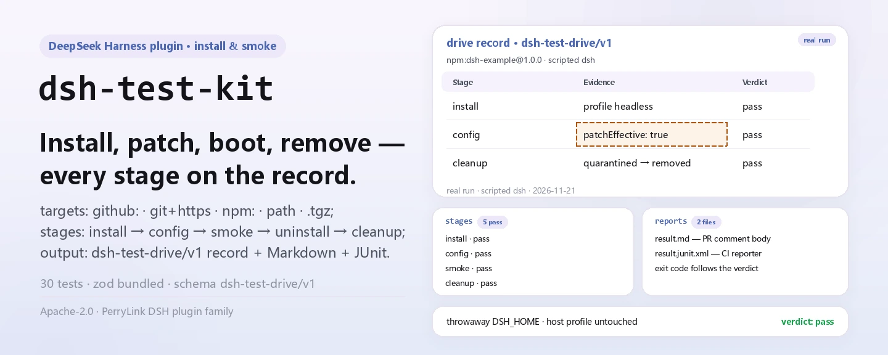
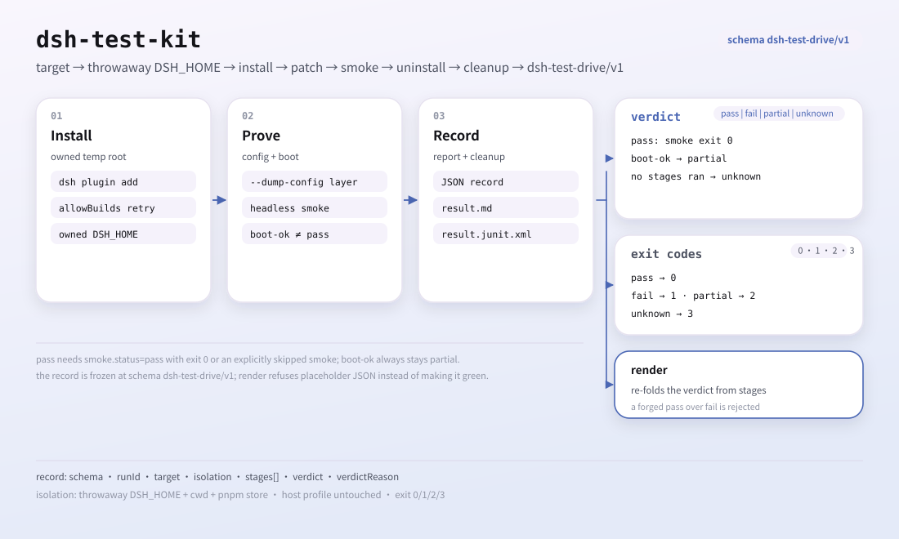
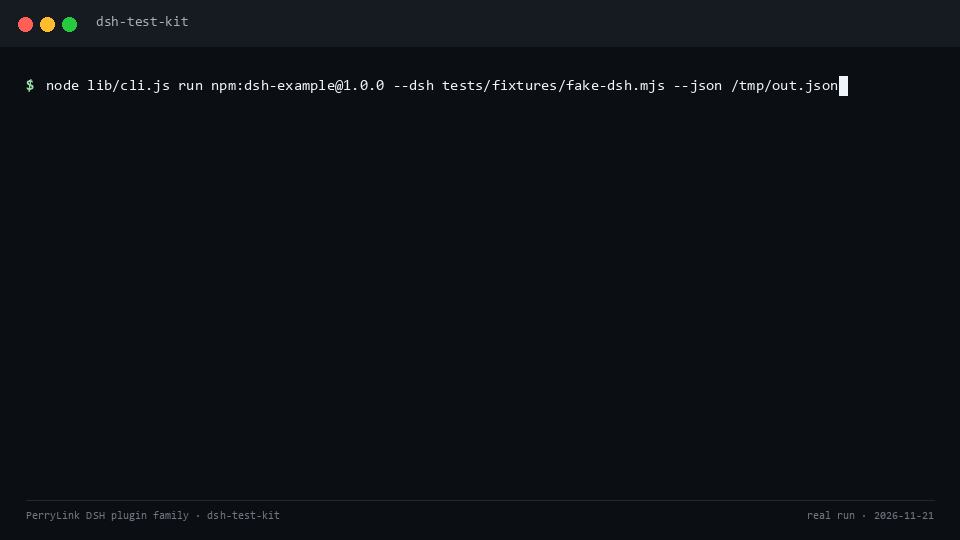

<div align="center">

<picture>
  <source media="(prefers-color-scheme: dark)" srcset="docs/assets/dsh-test-kit-hero-en-dark.webp">
  
</picture>

# dsh-test-kit

**Rode a checagem de instalação e arranque de um plugin do DeepSeek Harness fora do DeepSeek Harness.**

*Instalar → provar o patch → arrancar sem credenciais → desinstalar → limpar num `DSH_HOME` descartável, com o registro congelado `dsh-test-drive/v1` e os relatórios Markdown/JUnit como a única saída que conta.*

[English](README.md) · [简体中文](README-zh.md) · [Español](README-es.md) · [Português](README-pt.md) · [हिन्दी](README-hi.md)

[](https://github.com/PerryLink/dsh-test-kit/actions/workflows/ci.yml)
[](LICENSE)
[]()

</div>

O `dsh-test-kit` é o lar independente do motor `dsh-test-drive` extraído.
Ele instala um alvo num perfil `DSH_HOME` descartável, verifica que a camada de
patch do bundle realmente montou, executa um smoke de boot sem credenciais,
desinstala o pacote, limpa cada diretório que possui e grava o registro JSON
congelado `dsh-test-drive/v1` mais relatórios Markdown e JUnit.

Este repositório é autocontido: `src/core/` mora aqui, não é preciso checkout do
monorepo, nem import de runtime `@deepseek-ai/*`, nem processo anfitrião do DSH.
A única coisa de que um drive precisa é o CLI `dsh`, o pnpm e acesso de rede para
a instalação do perfil descartável.

- **Começa com Node puro.** O CLI empacota o `zod`; um checkout limpo sobe com
  `node lib/cli.js --version`.
- **Nunca relata sucesso para saída desconhecida.** JSON ausente ou inválido é
  rejeitado; `fail`, `partial` e `unknown` têm todos códigos de saída diferentes de zero.
- **`boot-ok` não é `pass`.** Um boot com saída diferente de zero e sem marcadores de
  falha de carregamento é `partial`; `pass` exige um boot real (`smoke.status=pass`,
  saída 0) ou um smoke pulado explicitamente.
- **Isolamento por construção.** `DSH_HOME` descartável, cwd descartável e store do
  pnpm redirecionado; o perfil do host nunca é lido nem escrito.
- **Relatórios higienizados.** Literais de token, credenciais de URL, cabeçalhos
  bearer e caminhos temporários são redigidos antes de chegar a qualquer relatório.

---

<picture>
  <source media="(prefers-color-scheme: dark)" srcset="docs/assets/dsh-test-kit-flow-v5-dark.svg">
  
</picture>

*Estrutura: instalar → provar → registrar; `verdict` e o código de saída derivam de `stages[]`, o `render` refaz o veredicto em vez de confiar na declaração do próprio registro, e os rótulos dentro do diagrama são os nomes reais de fases, flags e arquivos, então a mesma imagem serve aos cinco idiomas.*

## Status

- **Fonte da verdade:** este repositório. O pacote foi extraído do monorepo
  `dsh-test-drive` para uma árvore autocontida `src/` + `src/core/`.
- **npm:** ainda não publicado por este repositório. A publicação é feita pelo
  dono; até lá, compile a partir do código ou use a GitHub Action.
- **Schema:** congelado em `schema: "dsh-test-drive/v1"`. O kit não adiciona
  campos, então scorers e dashboards existentes continuam funcionando.
- **macOS:** verificado em CI hospedado no GitHub (`macos-latest`, Node 24). A
  máquina da extração não tem hardware macOS, então a execução local em macOS é
  **BLOQUEADA**; o job `macos-latest` do Actions é o resultado autoritativo de macOS.

## Requisitos

| Requisito | Observações |
|---|---|
| Node.js | `^22.19.0` ou `>=24.9.0` |
| CLI `dsh` | qualquer build 0.2.x que ofereça `plugin add` e `--dump-config`; passe `--dsh <caminho>` ou coloque `dsh` no `PATH` |
| Rede | só para a instalação pnpm do perfil descartável |
| pnpm | o gerenciador `dsh plugin` usa o seu próprio pnpm; é preciso um registry funcionando |

## Instalação

Quando o dono publicar o pacote:

```sh
npm install -g @perrylink/dsh-test-kit
dsh-test-kit --version
```

Até lá, compile o checkout independente:

```sh
git clone https://github.com/PerryLink/dsh-test-kit.git
cd dsh-test-kit
npm ci
npm run build
node lib/cli.js --version
```

`lib/cli.js` é uma única entrada ESM autocontida (zod empacotado); a compilação
falha se o zod for externalizado ou se a string de schema congelada faltar.

## Início rápido

```sh
# Um ref do GitHub (o caminho checkout/pack que os autores de plugins realmente publicam)
dsh-test-kit run github:owner/repo#<sha> --dsh /caminho/para/dsh --json out.json

# Um plugin publicado
dsh-test-kit run npm:dsh-score@0.2.28 --dsh /caminho/para/dsh --json out.json

# Um checkout local ou um tarball
dsh-test-kit run ./my-plugin --json out.json
dsh-test-kit run ./my-plugin.tgz --json out.json

# Renderize o par de relatórios de CI a partir do registro assentado
dsh-test-kit render --input out.json --out-dir reports
```

O `render` grava `reports/out.md` (corpo do comentário de PR) e
`reports/out.junit.xml` (entrada do reporter de testes) e então imprime uma linha
JSON com os caminhos absolutos e o veredicto.

## Alvos

| Forma | Exemplo | Observações |
|---|---|---|
| Ref do GitHub | `github:owner/repo#<sha>` | passado para `dsh plugin add` |
| URL git | `git+https://host/repo.git#ref` | qualquer spec git suportado pelo pnpm |
| Registry npm | `npm:name`, `npm:@scope/name@1.2.3` | o marcador `npm:` é removido antes de instalar |
| Caminho local | `./plugin`, `/abs/plugin` | ancorado no diretório de invocação |
| Tarball | `./plugin.tgz` | plugin empacotado |

## O registro de resultado

```json
{
  "schema": "dsh-test-drive/v1",
  "run": { "runId": "tdr_…", "harnessVersion": "0.2.2-rc.3", "pluginVersion": "0.1.0", "…": "…" },
  "target": { "kind": "npm", "spec": "dsh-score@0.2.28", "resolved": { "packageName": "dsh-score", "packageVersion": "0.2.28", "hasBundleManifest": true } },
  "stages": {
    "install":   { "status": "pass", "…": "…" },
    "config":    { "status": "pass", "patchEffective": true, "layers": ["dsh-score"], "…": "…" },
    "smoke":     { "status": "boot-ok", "bootFailed": false, "taskCompleted": false, "…": "…" },
    "uninstall": { "status": "pass", "…": "…" },
    "cleanup":   { "status": "pass", "quarantined": true, "removed": true, "…": "…" }
  },
  "verdict": "partial",
  "verdictReason": "install, patch, and uninstall verified; boot smoke exited 1 without loader-failure markers, so a successful boot is not proven"
}
```

`verdict=pass` exige `smoke.status=pass` com saída 0, ou um smoke pulado
explicitamente. Um boot com saída diferente de zero (`boot-ok`) é **sempre**
`partial`. Uma matriz vazia é `unknown`, nunca `pass`.

### Veredictos

| Veredicto | Significado | Código de saída do `run` |
|---|---|---|
| `pass` | install, camada de patch e uninstall verificados, mais um boot real (`smoke.pass` com saída 0) ou um smoke pulado explicitamente (task vazia / `--no-smoke`) | 0 |
| `fail` | install falhou, o boot encontrou falhas de carregamento (incluindo `Cannot find module`), ou uma asserção de capacidade falhou | 1 |
| `partial` | install passou, mas patch/boot/desinstalação não puderam ser totalmente verificados; `boot-ok` (saída diferente de zero) fica sempre aqui | 2 |
| `unknown` | a combinação de fases não tem regra conclusiva (normalmente o install nunca rodou) | 3 |

## Regras de integridade do `render` (correção P2)

O `render` refaz o veredicto a partir das fases do próprio registro antes de
gravar um relatório. Um registro que **declara `pass` enquanto suas fases dizem
outra coisa** nunca é renderizado em verde:

- qualquer fase falha (`install`, `config`, `smoke`, `capability`, `uninstall` ou
  `cleanup`) → o relatório mostra o `fail` derivado das fases, saída **1**;
- evidência parcial como `patchEffective: false` → o relatório mostra `partial`,
  saída **2**;
- evidência inconclusiva → `unknown`, saída **3**.

Portanto os códigos de saída do `render` são:

| Código | Significado |
|---|---|
| `0` | relatórios gravados a partir de um registro consistente |
| `1` | o registro declarava `pass`, mas uma fase é `fail` |
| `2` | o registro declarava `pass`, mas a evidência das fases é `partial` |
| `3` | o registro declarava `pass`, mas a evidência das fases é inconclusiva |
| `64` | erro de uso |
| `65` | a entrada não é um registro `dsh-test-drive/v1` (incluindo JSON de placeholder) |

JSON de placeholder como `{"note":"replace this step"}` é **rejeitado**, nunca
renderizado como sucesso.

### O que cada fase realmente verifica

1. **install** — `dsh plugin --profile <name> add <target>` no home descartável.
   Se uma fonte git bater na trava `allowBuilds` do pnpm, ela é permitida e a
   instalação é repetida uma vez.
2. **config** — `dsh --profile <name> --dump-config`; o pacote instalado precisa
   aparecer como layer ou como row. Sucesso do install sozinho não basta.
3. **smoke** — uma invocação headless. Saída 0 sem marcadores de falha de
   carregamento é `pass`; uma saída diferente de zero **não é um boot verificado**
   e dá `boot-ok` → veredicto `partial`; falhas de carregamento/módulo
   (`Cannot find module` etc.) o tornam `fail`. Uma task vazia pula a fase inteira
   (install/patch/uninstall ainda dão `pass`).
4. **capability** (opcional) — prova que uma tool/command nomeada está registrada,
   invocada e observada no log de sessão durável. Precisa de uma credencial de
   modelo encaminhada explicitamente; senão a fase é `skipped`, não falha.
5. **uninstall / cleanup** — remove o pacote e sempre executa a escada de
   quarentena → exclusão dos diretórios próprios, inclusive em abortos e erros de
   pipeline.

## GitHub Action

A action mora na raiz do repositório; referencie `@main` até existir uma tag de release:

```yaml
name: test-drive
on: [pull_request, workflow_dispatch]
jobs:
  smoke:
    runs-on: ubuntu-latest
    steps:
      - uses: actions/checkout@v4
      - name: Install the dsh CLI (or use your own cache)
        run: npm install -g @deepseek-ai/dsh@0.2.2-rc.3
      - name: Drive this plugin
        id: drive
        uses: PerryLink/dsh-test-kit@main
        with:
          target: github:${{ github.repository }}#${{ github.sha }}
          # Optional: headless-task: 'Reply with exactly: ok'
          # Optional: dsh: /usr/local/bin/dsh
      - name: Publish JUnit
        uses: EnricoMi/publish-unit-test-result-action@v2
        with:
          files: ${{ steps.drive.outputs.junit }}
      - name: Comment the report
        run: cat "${{ steps.drive.outputs.markdown }}"
```

| Entrada | Padrão | Propósito |
|---|---|---|
| `target` | — (obrigatório) | mesmas formas de alvo do CLI |
| `headless-task` | `''` | vazio pula a fase de smoke |
| `dsh` | `dsh` | caminho absoluto, comando simples ou `npm:<pkg>@<version>` |
| `node-version` | `24` | Node usado pelo kit |
| `kit-version` | `latest` | só usado quando o checkout não tem kit local |
| `allow-partial` | `false` | `partial` passa só quando permitido explicitamente |

Saídas: `markdown`, `junit`, `verdict`, `result`.

A action instala/compila o kit, roda o drive com `--no-fail`, valida e renderiza o
registro e então **faz o job falhar em `fail` ou `unknown`** (e em `partial` a menos
que `allow-partial: true`). Ela nunca substitui por um resultado de placeholder.

## Modelo de segurança

- **Apenas raízes temporárias próprias.** Cada diretório é criado com `mkdtemp` sob
  o diretório temporário do SO com o prefixo `dsh-test-drive-`, registrado e
  removido pela escada dry-run → rename para quarentena → exclusão. O
  `assertOwned` recusa qualquer outra coisa.
- **Perfil descartável.** O filho recebe `DSH_HOME=<owned root>/home`, um cwd
  descartável e `npm_config_store_dir=<owned root>/store`. O `~/.dsh` real nunca é
  lido nem escrito; o registro afirma `isolation.hostHomeTouched: false`.
- **Sem segredos implícitos.** O adaptador parte do ambiente pai menos os nomes
  com forma de credencial (`/KEY|PASSWORD|SECRET|TOKEN/i`) e todos os nomes
  `DSH_*`; só sobrevivem os valores nomeados com `--forward-env`.
- **Saída higienizada.** Toda string de relatório passa pelos sanitizadores do
  motor; a saída de fase é cortada por bytes e os caminhos temporários são redigidos.

## Estrutura do código

```
src/core/                  self-contained engine (10 modules)
  config.ts                defaults + fail-loud resolveConfig (no Schemastery)
  driver.ts                dsh location, argv-only spawning, allowBuilds, dump parsing
  drive.ts                 install → config → smoke → capability → uninstall → cleanup
  result.ts                frozen zod schema + verdictOf
  report.ts                Markdown + JUnit renderers
  workspace.ts             owned temp roots, quarantine ladder
  capability.ts            session-log capability analyzer
  session-log.ts           multi-frame zstd session reader
  sanitize.ts              secret/temp-path redaction
  version.ts               engine version

src/cli.ts                 run / render, argument parsing, exit codes
src/subprocess.ts          node:child_process adapter for the engine seam
action.yml                 composite GitHub Action
lib/cli.js                 built single-file bundle (committed so the Action needs no build)
tests/                     CLI + subprocess specs and the scripted fake dsh
```

A direção das dependências é única: o CLI importa o motor, o motor não importa
nada do DSH (as costuras de tipo vivem em `driver.ts`) e só o `subprocess.ts`
inicia processos. É isso que torna o `dsh-test-kit run` iniciável com Node puro.

## Desenvolvimento



*Animado: a saída real do CLI para `node lib/cli.js run npm:dsh-example@1.0.0 --dsh tests/fixtures/fake-dsh.mjs` seguida de `render` (re-executado em 2026-11-21). O `dsh` aqui é o fixture roteirizado que vem no repositório, então o ciclo completo run → registro → relatórios é real sem instalação de rede ou host do DSH; um alvo real usa o mesmo comando com `--dsh /caminho/para/dsh`.*

```sh
npm ci
npm run typecheck      # tsc --noEmit over src/ and tests/
npm test               # vitest: CLI + subprocess specs
npm run build          # tsdown bundle + self-contained bundle guard
npm run verify         # verify lib/cli.js bundles zod and the frozen schema
node lib/cli.js run npm:dsh-score@0.2.28 --json /tmp/out.json
node lib/cli.js render --input /tmp/out.json --out-dir /tmp/reports
```

Os testes usam um `dsh` roteirizado (`tests/fixtures/fake-dsh.mjs`), então o ciclo
completo run → JSON → render é exercitado sem instalação de rede. O teste de
regressão P2 forja `verdict: pass` sobre um install falho e verifica que o
`render` sai com `1` e grava um relatório `fail`.

## CI

O `.github/workflows/ci.yml` roda `npm ci`, typecheck, testes, build e
`node lib/cli.js --version` em:

| Job | Runner | Node |
|---|---|---|
| `test` | `ubuntu-latest`, `windows-latest` | 22, 24 |
| `macos` | `macos-latest` | 24 |
| `action` | `ubuntu-latest` | 24 |

O job `action` roda a composite action deste repositório de ponta a ponta contra
o `dsh` roteirizado e afirma um veredicto `pass`. O job `macos` existe porque a
máquina da extração não tem hardware macOS (execução local em macOS: BLOCKED); o
CI é a checagem autoritativa de macOS.

## Limites da v0.1

- Um alvo por `run`; matrizes em lote continuam sendo um recurso só do plugin
  (`/testdrive` + `drive-batch`).
- A fase de smoke é sem credenciais por padrão; encaminhar uma credencial de
  modelo é sempre uma decisão explícita de `--forward-env`.
- Windows: o adaptador se recusa a lançar shims `.cmd`/`.bat`/`.ps1` diretamente
  (sem shell). Passe um `.exe`, ou uma entrada JS/ESM (`.js`/`.mjs`/`.cjs`) — as
  entradas JS são lançadas via `node`.
- `--dsh npm:<pkg>@<version>` usa `npm exec --package=… -- dsh`; o npm precisa ser
  resolvível como entrada JS (o adaptador localiza o `npm-cli.js`).
- Este repositório ainda não cria git tag nem release no npm.

## Licença

Apache-2.0. O `zod` empacotado é MIT; veja [THIRD_PARTY_NOTICES.md](THIRD_PARTY_NOTICES.md).
