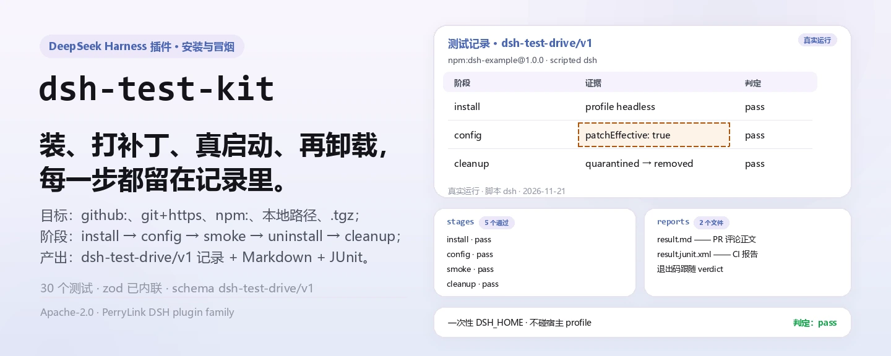
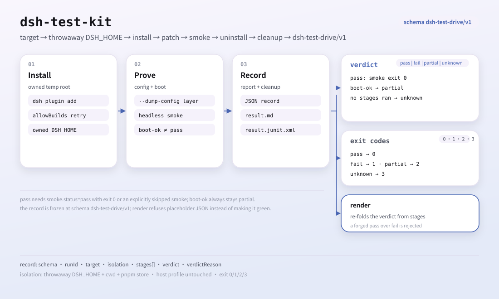
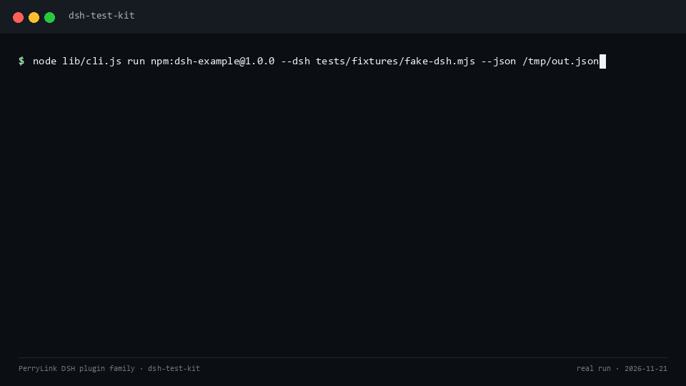

<div align="center">

<picture>
  <source media="(prefers-color-scheme: dark)" srcset="docs/assets/dsh-test-kit-hero-zh-dark.webp">
  
</picture>

# dsh-test-kit

**在 DeepSeek Harness 之外，跑通一个插件的安装与冒烟检查。**

*一次性 `DSH_HOME` 里走完：安装 → 补丁生效证明 → 无凭据真启动 → 卸载 → 清理；最终只有冻结 schema 的 `dsh-test-drive/v1` 记录和 Markdown / JUnit 报告算数。*

[English](README.md) · [Español](README-es.md) · [Português](README-pt.md) · [हिन्दी](README-hi.md)

[](https://github.com/PerryLink/dsh-test-kit/actions/workflows/ci.yml)
[](LICENSE)
[]()

</div>

`dsh-test-kit` 是抽出来的 `dsh-test-drive` 引擎的独立仓库。它把一个目标装进一次性的 `DSH_HOME` profile，核对 bundle 补丁层是否真的挂上，跑一次无凭据的启动冒烟，卸载包，清理它创建的每一个目录，并写出冻结 schema 的 `dsh-test-drive/v1` JSON 记录以及 Markdown 和 JUnit 报告。

本仓库自包含：`src/core/` 就在这里，不需要 monorepo checkout，不 import `@deepseek-ai/*` 运行时，也不需要 DSH 宿主进程。一次 drive 只需要 `dsh` CLI、pnpm，以及为一次性 profile 安装时的网络访问。

- **朴素的 Node 就能起。** CLI 把 `zod` 打了进去，干净 checkout 直接 `node lib/cli.js --version`。
- **未知输出绝不报成功。** 缺失或非法 JSON 一律拒绝；`fail`、`partial`、`unknown` 都有非零退出码。
- **`boot-ok` 不是 `pass`。** 非零退出且无加载失败标记只能是 `partial`；`pass` 要求真启动（`smoke.status=pass`、退出码 0），或显式跳过冒烟。
- **隔离是构造出来的。** 一次性 `DSH_HOME`、一次性 cwd、重定向的 pnpm store；宿主 profile 从不读也不写。
- **报告经过脱敏。** token 字面量、URL 里的凭据、bearer 头、临时路径，在进入任何报告字符串前都被抹掉。

---

<picture>
  <source media="(prefers-color-scheme: dark)" srcset="docs/assets/dsh-test-kit-flow-v5-dark.svg">
  
</picture>

*结构：安装 → 证明 → 记录；`verdict` 与退出码都由 `stages[]` 推导，`render` 会重新折叠判定而不是相信记录自己的声明；图内只有真实的阶段名、参数名与文件名，五语共用同一张结构图。*

## 状态

- **事实源：** 本仓库。包从 `dsh-test-drive` monorepo 抽出，成为自包含的 `src/` + `src/core/` 树。
- **npm：** 本仓库尚未发布。发布由 owner 处理；在那之前，从源码构建或使用 GitHub Action。
- **Schema：** 冻结在 `schema: "dsh-test-drive/v1"`。本 kit 不新增字段，既有打分器与仪表盘继续可用。
- **macOS：** 已在 GitHub 托管的 CI（`macos-latest`、Node 24）上验证。抽取用机器没有 macOS 硬件，所以本地 macOS 运行是 **BLOCKED**；`macos-latest` Actions job 才是权威的 macOS 结果。

## 环境要求

| 要求 | 说明 |
|---|---|
| Node.js | `^22.19.0` 或 `>=24.9.0` |
| `dsh` CLI | 任意 0.2.x 构建，需提供 `plugin add` 和 `--dump-config`；用 `--dsh <path>` 指定，或把 `dsh` 放进 `PATH` |
| 网络 | 只用于一次性 profile 的 pnpm 安装 |
| pnpm | `dsh plugin` 管理器用它自己的 pnpm；需要一个可用的 registry |

## 安装

等 owner 发布这个包之后：

```sh
npm install -g @perrylink/dsh-test-kit
dsh-test-kit --version
```

在那之前，构建这个独立 checkout：

```sh
git clone https://github.com/PerryLink/dsh-test-kit.git
cd dsh-test-kit
npm ci
npm run build
node lib/cli.js --version
```

`lib/cli.js` 是单个自包含 ESM 入口（zod 已内联）；如果 zod 被外置，或冻结的 schema 字符串缺失，构建会失败。

## 快速开始

```sh
# 一个 GitHub ref（插件作者实际发布的 checkout/pack 路径）
dsh-test-kit run github:owner/repo#<sha> --dsh /path/to/dsh --json out.json

# 一个已发布的插件
dsh-test-kit run npm:dsh-score@0.2.28 --dsh /path/to/dsh --json out.json

# 本地 checkout 或 tarball
dsh-test-kit run ./my-plugin --json out.json
dsh-test-kit run ./my-plugin.tgz --json out.json

# 从落定的记录生成那一对 CI 报告
dsh-test-kit render --input out.json --out-dir reports
```

`render` 写出 `reports/out.md`（PR 评论正文）和 `reports/out.junit.xml`（测试报告器输入），然后打印一行 JSON，包含绝对路径与判定。

## 目标形式

| 形式 | 示例 | 说明 |
|---|---|---|
| GitHub ref | `github:owner/repo#<sha>` | 传给 `dsh plugin add` |
| git URL | `git+https://host/repo.git#ref` | 任意 pnpm 支持的 git spec |
| npm registry | `npm:name`、`npm:@scope/name@1.2.3` | 安装前会剥掉 `npm:` 标记 |
| 本地路径 | `./plugin`、`/abs/plugin` | 以调用目录为锚点 |
| tarball | `./plugin.tgz` | 打包好的插件 |

## 结果记录

```json
{
  "schema": "dsh-test-drive/v1",
  "run": { "runId": "tdr_…", "harnessVersion": "0.2.2-rc.3", "pluginVersion": "0.1.0", "…": "…" },
  "target": { "kind": "npm", "spec": "dsh-score@0.2.28", "resolved": { "packageName": "dsh-score", "packageVersion": "0.2.28", "hasBundleManifest": true } },
  "stages": {
    "install":   { "status": "pass", "…": "…" },
    "config":    { "status": "pass", "patchEffective": true, "layers": ["dsh-score"], "…": "…" },
    "smoke":     { "status": "boot-ok", "bootFailed": false, "taskCompleted": false, "…": "…" },
    "uninstall": { "status": "pass", "…": "…" },
    "cleanup":   { "status": "pass", "quarantined": true, "removed": true, "…": "…" }
  },
  "verdict": "partial",
  "verdictReason": "install, patch, and uninstall verified; boot smoke exited 1 without loader-failure markers, so a successful boot is not proven"
}
```

`verdict=pass` 要求 `smoke.status=pass` 且退出码 0，或显式跳过冒烟。非零启动（`boot-ok`）**永远**是 `partial`。空矩阵是 `unknown`，绝不是 `pass`。

### 判定

| 判定 | 含义 | `run` 退出码 |
|---|---|---|
| `pass` | install、补丁层、uninstall 均已验证，且要么真启动（`smoke.pass` 且退出码 0），要么显式跳过冒烟（空 task / `--no-smoke`） | 0 |
| `fail` | install 失败、启动时发现加载失败（包括 `Cannot find module`），或能力断言失败 | 1 |
| `partial` | install 通过，但补丁/启动/卸载无法完全验证；`boot-ok`（非零退出）永远属于这里 | 2 |
| `unknown` | 阶段组合没有可下结论的规则（通常是从未跑过 install） | 3 |

## `render` 的完整性规则（P2 修复）

`render` 在写报告之前，会用记录自己的 stages 重新折叠判定。**声明 `pass` 而 stages 并不支持**的记录，永远不会被渲染成绿色：

- 任何失败阶段（`install`、`config`、`smoke`、`capability`、`uninstall`、`cleanup`）→ 报告显示由阶段推导出的 `fail`，退出码 **1**；
- 部分证据，例如 `patchEffective: false` → 报告显示 `partial`，退出码 **2**；
- 证据不足以下结论 → `unknown`，退出码 **3**。

因此 `render` 的退出码是：

| 退出码 | 含义 |
|---|---|
| `0` | 记录自洽，报告已写出 |
| `1` | 记录声明 `pass`，但有阶段是 `fail` |
| `2` | 记录声明 `pass`，但阶段证据是 `partial` |
| `3` | 记录声明 `pass`，但阶段证据无法下结论 |
| `64` | 用法错误 |
| `65` | 输入不是 `dsh-test-drive/v1` 记录（包括占位 JSON） |

占位 JSON 例如 `{"note":"replace this step"}` 会被**拒绝**，绝不渲染成成功。

### 各阶段到底检查什么

1. **install** —— 在一次性 home 里执行 `dsh plugin --profile <name> add <target>`。git 源上撞到 pnpm `allowBuilds` 闸门时，会加白名单并重试一次。
2. **config** —— `dsh --profile <name> --dump-config`；装上的包必须以 layer 或 row 的形式出现。只装成功还不够。
3. **smoke** —— 一次 headless 调用。退出码 0 且无加载失败标记是 `pass`；非零退出**不是一次被验证的启动**，只给 `boot-ok` → 判定 `partial`；加载/模块失败（`Cannot find module` 等）则记 `fail`。空 task 会整段跳过冒烟（install/patch/uninstall 仍然给出 `pass`）。
4. **capability**（可选）—— 证明某个具名 tool/command 已注册、被调用、并出现在持久的会话日志里。需要显式转发模型凭据；否则该阶段是 `skipped`，不是失败。
5. **uninstall / cleanup** —— 卸载包，并且永远走完自有的 quarantine → delete 阶梯，包括中途 abort 和 pipeline 报错的情况。

## GitHub Action

Action 位于仓库根目录；在有正式 release tag 之前引用 `@main`：

```yaml
name: test-drive
on: [pull_request, workflow_dispatch]
jobs:
  smoke:
    runs-on: ubuntu-latest
    steps:
      - uses: actions/checkout@v4
      - name: Install the dsh CLI (or use your own cache)
        run: npm install -g @deepseek-ai/dsh@0.2.2-rc.3
      - name: Drive this plugin
        id: drive
        uses: PerryLink/dsh-test-kit@main
        with:
          target: github:${{ github.repository }}#${{ github.sha }}
          # Optional: headless-task: 'Reply with exactly: ok'
          # Optional: dsh: /usr/local/bin/dsh
      - name: Publish JUnit
        uses: EnricoMi/publish-unit-test-result-action@v2
        with:
          files: ${{ steps.drive.outputs.junit }}
      - name: Comment the report
        run: cat "${{ steps.drive.outputs.markdown }}"
```

| 输入 | 默认值 | 用途 |
|---|---|---|
| `target` | —（必填） | 与 CLI 相同的目标形式 |
| `headless-task` | `''` | 为空则跳过冒烟阶段 |
| `dsh` | `dsh` | 绝对路径、裸命令，或 `npm:<pkg>@<version>` |
| `node-version` | `24` | kit 使用的 Node |
| `kit-version` | `latest` | 仅当 checkout 里没有本地 kit 时使用 |
| `allow-partial` | `false` | 只有显式允许时 `partial` 才算通过 |

输出：`markdown`、`junit`、`verdict`、`result`。

Action 会安装/构建 kit，用 `--no-fail` 跑一次 drive，校验并渲染记录，然后在 `fail` 或 `unknown` 时**让 job 失败**（`partial` 也会失败，除非 `allow-partial: true`）。它从不替换成占位结果。

## 安全模型

- **只用自有的临时根目录。** 每个目录都用 `mkdtemp` 在 OS 临时目录下创建，前缀 `dsh-test-drive-`，登记在案，并走 dry-run → quarantine-rename → delete 阶梯删除。`assertOwned` 拒绝其他任何路径。
- **一次性 profile。** 子进程拿到 `DSH_HOME=<owned root>/home`、一次性 cwd 和 `npm_config_store_dir=<owned root>/store`。真实的 `~/.dsh` 从不读也不写；记录里断言 `isolation.hostHomeTouched: false`。
- **没有隐式密钥。** 适配器从父进程环境出发，先剔除形似凭据的名字（`/KEY|PASSWORD|SECRET|TOKEN/i`）和所有 `DSH_*` 名字；只有用 `--forward-env` 点名的值才会留下。
- **输出脱敏。** 每个报告字符串都过引擎的 sanitizer；阶段输出按字节截断，临时路径被抹掉。

## 源码布局

```
src/core/                  self-contained engine (10 modules)
  config.ts                defaults + fail-loud resolveConfig (no Schemastery)
  driver.ts                dsh location, argv-only spawning, allowBuilds, dump parsing
  drive.ts                 install → config → smoke → capability → uninstall → cleanup
  result.ts                frozen zod schema + verdictOf
  report.ts                Markdown + JUnit renderers
  workspace.ts             owned temp roots, quarantine ladder
  capability.ts            session-log capability analyzer
  session-log.ts           multi-frame zstd session reader
  sanitize.ts              secret/temp-path redaction
  version.ts               engine version

src/cli.ts                 run / render, argument parsing, exit codes
src/subprocess.ts          node:child_process adapter for the engine seam
action.yml                 composite GitHub Action
lib/cli.js                 built single-file bundle (committed so the Action needs no build)
tests/                     CLI + subprocess specs and the scripted fake dsh
```

依赖方向是单向的：CLI import 引擎，引擎不从 DSH import 任何东西（类型接缝在 `driver.ts`），只有 `subprocess.ts` 会启动进程。正因如此，`dsh-test-kit run` 用朴素的 Node 就能跑起来。

## 开发



*动图是 CLI 的真实输出：先 `node lib/cli.js run npm:dsh-example@1.0.0 --dsh tests/fixtures/fake-dsh.mjs`，再 `render`（2026-11-21 复跑）。这里的 `dsh` 是仓库自带的脚本化 fixture，所以完整的 run → 记录 → 报告闭环、不联网、不需要 DSH 宿主都是真的；换真实目标只需把 `--dsh` 指向本机 dsh。*

```sh
npm ci
npm run typecheck      # tsc --noEmit over src/ and tests/
npm test               # vitest: CLI + subprocess specs
npm run build          # tsdown bundle + self-contained bundle guard
npm run verify         # verify lib/cli.js bundles zod and the frozen schema
node lib/cli.js run npm:dsh-score@0.2.28 --json /tmp/out.json
node lib/cli.js render --input /tmp/out.json --out-dir /tmp/reports
```

测试使用脚本化的 `dsh`（`tests/fixtures/fake-dsh.mjs`），所以完整的 run → JSON → render 闭环不需要网络安装就能被覆盖。P2 回归测试在失败的 install 上伪造 `verdict: pass`，断言 `render` 退出码为 `1` 并写出 `fail` 报告。

## CI

`.github/workflows/ci.yml` 在以下矩阵上运行 `npm ci`、typecheck、测试、构建以及 `node lib/cli.js --version`：

| Job | Runner | Node |
|---|---|---|
| `test` | `ubuntu-latest`、`windows-latest` | 22、24 |
| `macos` | `macos-latest` | 24 |
| `action` | `ubuntu-latest` | 24 |

`action` job 对着脚本化的 `dsh` 端到端运行本仓库的 composite action，并断言 `pass` 判定。`macos` job 存在的原因是抽取用机器没有 macOS 硬件（本地 macOS 运行：BLOCKED）；CI 才是权威的 macOS 检查。

## v0.1 限制

- 一次 `run` 只测一个目标；批量矩阵仍是插件侧功能（`/testdrive` + `drive-batch`）。
- 冒烟阶段默认无凭据；转发模型凭据永远是显式的 `--forward-env` 决定。
- Windows：适配器拒绝直接 spawn `.cmd`/`.bat`/`.ps1` shim（不经过 shell）。请传 `.exe`，或 JS/ESM 入口（`.js`/`.mjs`/`.cjs`）—— JS 入口会通过 `node` 启动。
- `--dsh npm:<pkg>@<version>` 使用 `npm exec --package=… -- dsh`；npm 必须能以 JS 入口解析（适配器会定位 `npm-cli.js`）。
- 本仓库目前还不创建 git tag 或 npm release。

## 许可

Apache-2.0。内联的 `zod` 是 MIT；见 [THIRD_PARTY_NOTICES.md](THIRD_PARTY_NOTICES.md)。
